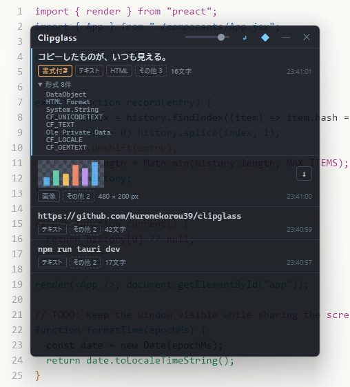

<div align="center">

# Clipglass

[](https://github.com/kuronekorou39/clipglass/actions/workflows/ci.yml)
[](LICENSE)
[](SPEC.md)
[](https://v2.tauri.app/)

**コピーしたものが、いつも見える。半透明の小窓でクリップボードを確認する Windows アプリ**



</div>

## インストール

[GitHub Releases](https://github.com/kuronekorou39/clipglass/releases) から最新の `Clipglass_x.y.z_x64-setup.exe` をダウンロードして実行してください。対応 OS は Windows 11 (x64) です。

## 主な機能

- クリップボードの履歴を、常に手前の半透明ウィンドウに一覧表示(件数は設定で変更。初期値 10 件)
- テキスト・画像・ファイルのコピーに対応。行をクリックすると再コピーし、同じ内容は重複せず先頭へ移動
- 書式付きのコピー(HTML / RTF)にはバッジを表示。書式ごと、または文字だけを選んで再コピー
- 画像はプレビューし、元の寸法のまま PNG で保存
- 右クリックで行の固定(件数の上限で消えず、次回の起動でも残る)と削除。必要なときだけ開く検索と種類での絞り込み
- プリセット: よく使う文字を階層で登録し、下部のボタンから開いてクリックでコピー。履歴からはボタン1つで登録でき、名前・文字・フォルダー・並びはアプリの中で編集できる(中身は YAML ファイル)
- 通知領域に常駐し、ショートカット(初期値 Alt+Shift+Q。設定でキーを押して変更)でウィンドウを出し入れ。Windows へのサインイン時の自動起動
- 不透明度と文字サイズの調整(初期設定では背景だけを透かし、文字はくっきり残す)、読み取りの一時停止
- リモートデスクトップでも扱いやすい移動とサイズ変更(広めの縁、右下のつまみ、Ctrl+Shift+矢印での移動、Ctrl+Shift+Alt+矢印でのサイズ変更、画面の四隅への配置)
- 履歴は初期設定ではメモリー上だけに保持。設定で有効にした場合と固定した項目だけをディスクに保存し、外部には送らない

コピー内容は種類を問わずそのまま表示します。パスワードなども隠さないので、画面共有時は注意してください。

## プリセット

ふだんはアプリの中(プリセットの「＋」と ✎)で編集できます。まとめて書くときは、プリセットの「場所」でエクスプローラーに `presets.yaml` を表示して開き、「名前: 文字」の形で書きます。名前の下に字下げして書くとフォルダーになり、何段でも入れ子にできます。

```yaml
挨拶:
  朝: おはようございます
  締め: |
    以上、よろしくお願いいたします。
    山田
メール: example@example.com
```

ファイルは `%APPDATA%\com.clipglass.app\` にあり、設定(`config.yaml`)と保存した履歴(`history\`)も同じ場所です。

## 開発

```bash
npm install
npm run tauri dev           # 開発モードで起動
npm run tauri build         # インストーラーを作成
.\scripts\build_exe.ps1     # exe・zip・インストーラーを release\ にまとめる(PowerShell)
npm test                    # フロントエンドのテスト
cd src-tauri && cargo test  # Rust のテスト
```

前提: Node.js 22+、Rust (stable)。仕様は [SPEC.md](SPEC.md) を参照してください。

## リリース

1. `package.json` と `src-tauri/Cargo.toml` の `version` を上げる(修正のたびに必ず上げる)
2. `v` を付けた同じ番号のタグを push する(例: `v0.1.1`)
3. GitHub Actions がインストーラーをビルドし、ドラフトのリリースに添付する

## ライセンス

[MIT](LICENSE)
