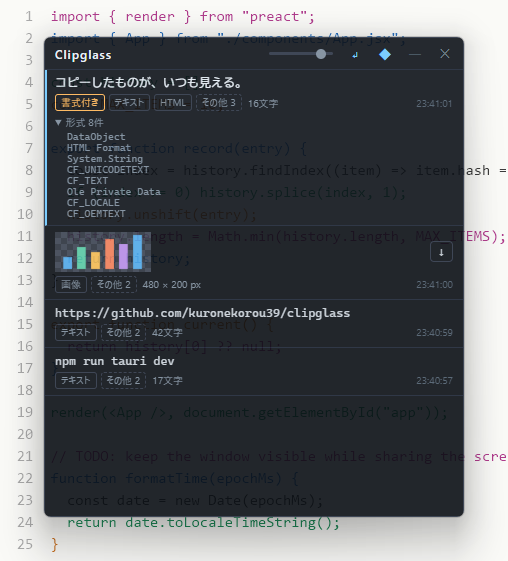

<div align="center">

# Clipglass

[](LICENSE)
[](SPEC.md)
[](https://v2.tauri.app/)

**コピーしたものが、いつも見える。半透明の小窓でクリップボードを確認する Windows アプリ**



</div>

## インストール

[GitHub Releases](https://github.com/kuronekorou39/clipglass/releases) から最新版をダウンロードしてください。Python やビルド環境は要りません。対応 OS は Windows 11 (x64) です。

- **zip(おすすめ)**: `Clipglass-x.y.z-portable.zip` を展開し、中の `Clipglass.exe` を実行する
- **インストーラー**: `Clipglass_x.y.z_x64-setup.exe` を実行する

どちらもコード署名をしていないため、初回は Windows SmartScreen の警告が出ることがあります。発行元を確認したうえで使う場合は「詳細情報」→「実行」で進めてください。

## 主な機能

- クリップボードの履歴を、常に手前の半透明ウィンドウに一覧表示(件数は設定で変更。初期値 100 件)
- テキスト・画像・ファイルのコピーに対応。行をクリックすると再コピーし、同じ内容は重複せず先頭へ移動
- 書式付きのコピー(HTML / RTF)にはバッジを表示。書式ごと、または文字だけを選んで再コピー
- 画像はプレビューし、元の寸法のまま PNG で保存
- 行をクリックすると、直前に使っていたアプリのカーソル位置へそのまま貼り付け(設定でコピーだけにもできる)
- 一覧の上から9件には 1〜9 の番号が付き、数字キーを押すだけで選んで貼り付け(ショートカットで出して、そのまま数字を押す)
- 件数の上限を超えた古い項目も「過去の履歴」として一定期間(日数と大きさで整理)残し、さかのぼって見たり探したりできる
- 右クリックでお気に入りへの追加・プリセットへの追加・削除。必要なときだけ開く検索と種類での絞り込み
- お気に入り: しばらく使う文字をフォルダーなしで並べる。同じ文字が履歴に出ると星が付く
- 色合いを選べる(ダーク、ライト、XP 風、クラシック、ターミナル)
- プリセット: よく使う文字を階層で登録し、下部のボタンから本体の横(一覧に重ならない別ウィンドウ)に開いてクリックでコピー。履歴からは右クリックで入れるフォルダーを選んで追加でき、名前・文字・フォルダー・並びはアプリの中で編集できる(中身は YAML ファイル)
- 通知領域に常駐し、ショートカット(初期値 Alt+Shift+Q。設定でキーを押して変更)でマウスのそばにウィンドウを出し、もう一度押すと隠す。Windows へのサインイン時の自動起動
- 不透明度と文字サイズの調整(初期設定では背景だけを透かし、文字はくっきり残す)、読み取りの一時停止
- リモートデスクトップでも扱いやすい移動とサイズ変更(幅は 200px まで細くできる。広めの縁、左下と右下のつまみ、Ctrl+Shift+矢印での移動、Ctrl+Shift+Alt+矢印でのサイズ変更、画面の四隅への配置)
- 履歴と過去の履歴は、設定「次回の起動でも残す」が有効なとき(初期値)だけディスクに保存し、外部には送らない。無効にするとディスクから消す

コピー内容は種類を問わずそのまま表示します。パスワードなども隠さないので、画面共有時は注意してください。

## プリセット

ふだんはアプリの中(プリセットの「＋」と ✎)で編集できます。まとめて書くときは、プリセットの「場所」でエクスプローラーに `presets.yaml` を表示して開き、「名前: 文字」の形で書きます。名前の下に字下げして書くとフォルダーになり、何段でも入れ子にできます。

```yaml
挨拶:
  朝: おはようございます
  締め: |
    以上、よろしくお願いいたします。
    山田
メール: example@example.com
```

ファイルは `%APPDATA%\com.clipglass.app\` にあり、設定(`config.yaml`)と保存した履歴(`history\`)も同じ場所です。

## 開発

```bash
npm install
npm run tauri dev           # 開発モードで起動
npm run tauri build         # インストーラーを作成
.\scripts\build_exe.ps1     # exe・zip・インストーラーを release\ にまとめる(PowerShell)
npm test                    # フロントエンドのテスト
cd src-tauri && cargo test  # Rust のテスト
```

前提: Node.js 22+、Rust (stable)。仕様は [SPEC.md](SPEC.md) を参照してください。

## リリース

1. `package.json` と `src-tauri/Cargo.toml` の `version` を上げる(修正のたびに必ず上げる)
2. `v` を付けた同じ番号のタグを push する(例: `v0.1.1`)
3. GitHub Actions が zip とインストーラーをビルドし、ドラフトのリリースに添付する

## ライセンス

[MIT](LICENSE)
